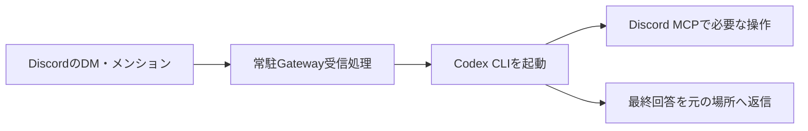

# Discord Lucas MCP

Discord Botの公式APIを操作するstdio MCPサーバーと、DM・メンションからCodex CLIを起動する受信処理。

投稿、添付、ピン留め、チャンネル作成、招待、ロール、Webhook、スレッド等を扱う。本体削除・一括削除・BAN・キック・管理者権限の付与を通信前に拒否する。

## インストール

Python 3.11以上を使用する。

```powershell
git clone https://github.com/menma22/discord-lucas-mcp.git
cd discord-lucas-mcp
python -m venv .venv
& .venv/Scripts/python.exe -m pip install .
```

MCP本体はWindows以外でも利用できる。Gateway受信処理の常駐・二重起動防止はWindows向け。

## 認証とCodexへの登録

Botトークンはリポジトリの外のファイルへ保存する。

```dotenv
DISCORD_BOT_TOKEN=YOUR_DISCORD_BOT_TOKEN
```

ファイルの絶対パスを指定して登録する。トークン本体をコマンドの引数へ書かない。

```powershell
$discordPython = (Resolve-Path .venv/Scripts/python.exe).Path
codex mcp add discord-lucas --env DISCORD_TOKEN_FILE=C:/path/outside-repo/discord.env -- $discordPython -m discord_lucas_mcp
```

`discord-lucas-mcp`コマンドでも起動できる。MCP単体では`DISCORD_BOT_TOKEN`環境変数も使用できる。既存のClaude Discord設定がある場合は、未指定時にユーザー領域の`.claude/channels/discord/.env`を読む。

| ツール | 用途 |
|---|---|
| `discord_read` | 公式APIの読み取り |
| `discord_write` | 許可済みAPIでの作成・投稿・編集・管理 |
| `discord_upload` | 明示されたローカルファイルの投稿 |

必要な個別権限をBotに与え、対象サーバーに招待する。権限とロール階層によるDiscord側の制限は引き続き適用される。サーバー所有者専用操作や個人アカウントとしての操作は扱わない。

## DM・メンションからのCodex自動起動

追加依存をインストールし、[設定例](examples/listener.example.json)をリポジトリ外へコピーして実際のID・絶対パス・利用するCodexモデル名を指定する。`python_path`にはこのパッケージをインストールしたPythonを指定する。Codex CLIのログインも事前に完了させる。

```powershell
& .venv/Scripts/python.exe -m pip install ".[gateway]"
$env:DISCORD_TOKEN_FILE = 'C:/path/outside-repo/discord.env'
& .venv/Scripts/discord-lucas-listener.exe --config 'C:/path/outside-repo/listener.json'
```

設定の選択順は`--config`、`DISCORD_LUCAS_CONFIG`、現在の作業フォルダの`listener.json`。状態・診断・アップロード用ファイルは設定した`runtime_dir`と`attachment_root`へ置く。



- 対象サーバーの人間による実メンションとBotへの返信を受信する。
- DMは`dm_allowed_user_ids`の許可ユーザー、または対象サーバー在籍者だけを受信する。
- Bot・Webhook・他サーバー・無関係な通常投稿を処理しない。
- 特権のMessage Content Intentは要求しない。DMと実メンションでは本文を取得できる。メンションを外した返信は本文を取得できない場合があるため、本文付き返信にはBotへのメンションを含める。
- チャンネルごとに順番に処理し、直近の会話履歴を保持する。受信IDを記録して重複実行を防ぐ。
- 返信は永続outboxへ保存し、接続復旧時と接続中30秒ごとに未配送だけを回復する。結果不明なら既存返信を照合し、nonceも使用する。確定したHTTP拒否を連投しない。
- Codexの操作自体を自動再実行しない。停止中に届いた過去の投稿を自動処理しない。
- 通常の受信にはGateway接続を維持する必要がある。PC停止・スリープ・ネット切断中は返信できない。

Windowsのログイン時に自動起動する場合は、タスクスケジューラから上記listenerコマンドを起動する。引数に設定ファイルを指定し、起動環境に`DISCORD_TOKEN_FILE`を設定する。このパッケージのインストールだけではタスクを登録しない。

## 自動実行の範囲

子CodexにはこのMCPの3ツールだけを登録し、個人のAGENTS・スキル・他MCP・Apps・シェル・画像・ブラウザ・hook・記憶機能を読み込ませない。MCP書き込みとアップロードには個別の`approval_mode="approve"`を指定する。単なる`approval_policy="never"`は書き込みMCPの自動許可にはならない。

自動応答の読み書きは対象サーバーと、その実行で受信したDMのチャンネルに限定する。添付は専用フォルダ内だけを許可する。ファイルの名前とURLを受け取るが、添付文書の本文のダウンロード・解析は含まない。

削除禁止はこのMCPの通信境界で適用する。同じBotトークンを別のソフトで使用した場合のDiscord側の削除能力をなくすものではない。ピン解除、ロール解除、内容を残すアーカイブ、通常の本文編集は許可する。既存添付一覧の置き換えは拒否し、追加添付は許可する。

## 開発・検証

```powershell
& .venv/Scripts/python.exe -m pip install ".[gateway,test]"
& .venv/Scripts/python.exe -m unittest discover -s tests -v
& .venv/Scripts/python.exe -m build
```

テストは模擬通信を使用し、実Discordへの投稿・削除や実Codexの推論を行わない。GitHub Actionsでもテストとwheel・ソース配布のビルドを行う。

## 公開範囲

公開するのは本体・テスト・汎用設定例・ビルド定義。実トークン、個人設定、サーバー・メンバーの実ID、会話履歴、受信DB、ログ、ローカルの仮想環境は含めない。`.gitignore`で除外し、公開前に追跡対象と配布ファイルを確認する。ライセンスは未指定。

参照: [Discord Gateway](https://docs.discord.com/developers/events/gateway)、[Discord権限](https://docs.discord.com/developers/topics/permissions)、[Codex MCP設定](https://learn.chatgpt.com/docs/config-file/config-reference)。
